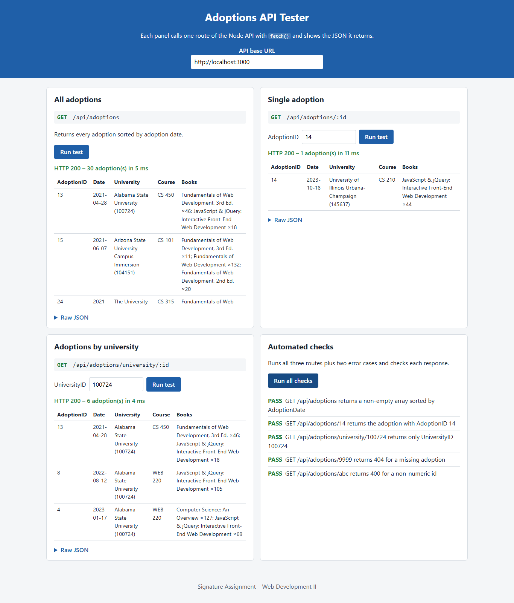
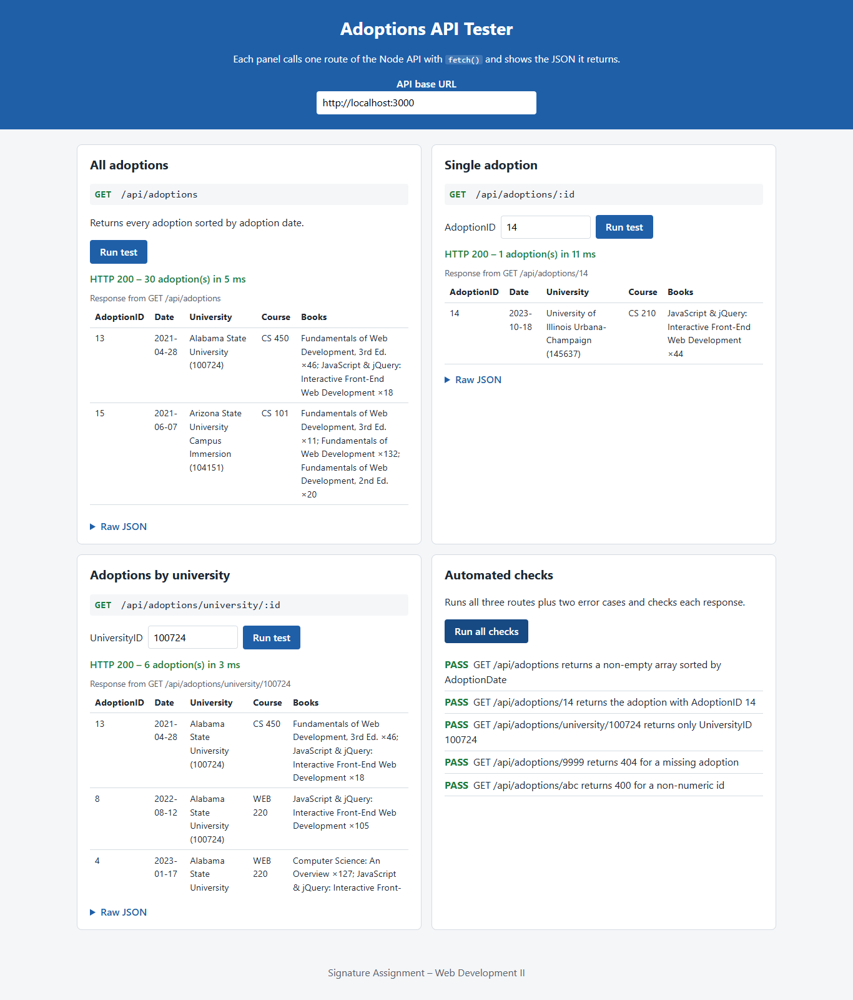
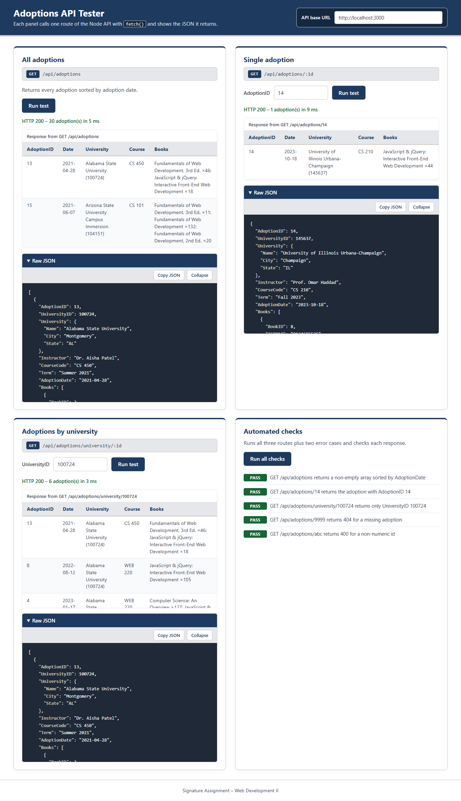
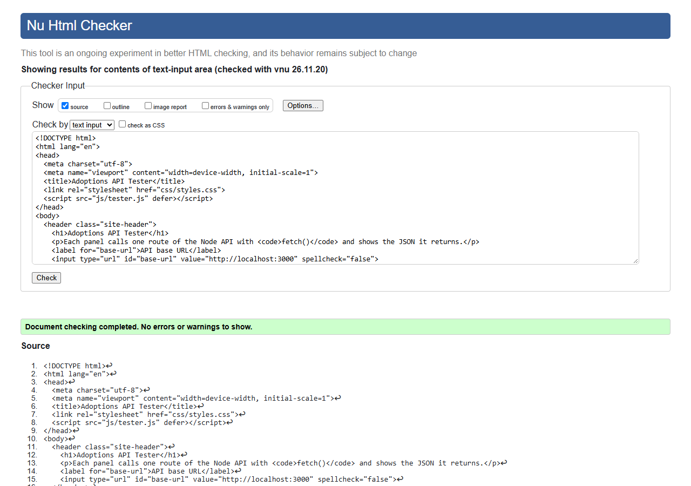
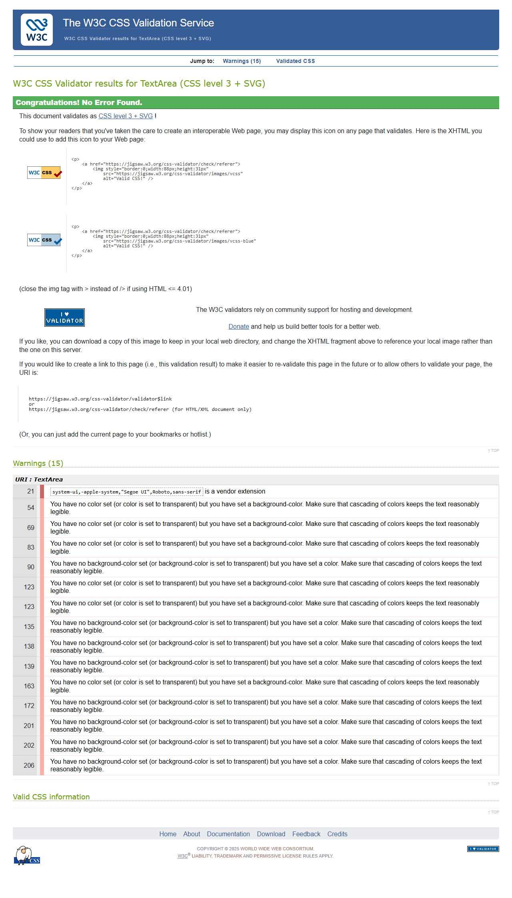
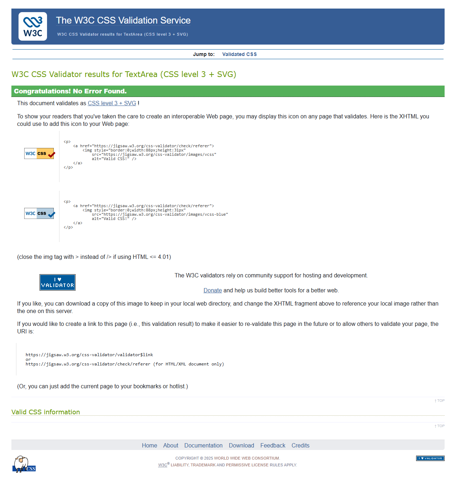

# Lab Report: Adoptions API with MongoDB, Node.js/Express and a fetch() Test Page

| | |
|---|---|
| **Student** | Jordana Eleanne Puentes Hidalgo |
| **Institution** | Keiser University — B.S. in Software Engineering |
| **Course** | Web Development II (Signature Assignment — Chapter 14, Project 2) |
| **Date** | November 25, 2026 |

---

## 1. Project Overview

The goal was to store textbook-adoption records in MongoDB, expose them through a Node.js REST API, and
check every route from a browser page that uses the Fetch API.

| Layer | Technology |
|---|---|
| Database | MongoDB 9.0: database `project3`, collection `adoptions` |
| Data access | Official `mongodb` Node.js driver (`MongoClient`) |
| Server | Node.js 24 + Express 5 |
| Client | HTML5, CSS3 (Grid/Flexbox), vanilla JavaScript with `fetch()` |
| Validation | W3C Nu Html Checker, W3C CSS Validator, axe-core |

> **Note on Mongoose:** `mongoose` is listed in `package.json`, but the project doesn't use it. The
> API and seed script use the official MongoDB driver directly, because each route is a single query
> and doesn't need a schema layer.

---

## 2. MongoDB Setup & Sample Queries

### 2.1 Data set

The handout didn't include the data file, so I created [`data/adoptions.json`](data/adoptions.json):
**30 adoption documents** from 13 universities, using real IPEDS university IDs. Six of them belong to UniversityID
**100724** (Alabama State University), so the sample query returns useful results. Each document has this shape:

```json
{
  "AdoptionID": 14,
  "UniversityID": 145637,
  "University": { "Name": "University of Illinois Urbana-Champaign", "City": "Champaign", "State": "IL" },
  "Instructor": "Prof. Omar Haddad",
  "CourseCode": "CS 210",
  "Term": "Fall 2023",
  "AdoptionDate": "2023-10-18",
  "Books": [ { "BookID": 8, "ISBN10": "0134605535", "Title": "JavaScript & jQuery: …", "Quantity": 44 } ]
}
```

`AdoptionDate` is stored as an ISO `YYYY-MM-DD` string, so sorting it as text also sorts it by date.

### 2.2 Import

With `mongod` running in a separate terminal:

```bash
mongoimport --db project3 --collection adoptions --file data/adoptions.json --jsonArray
```

The command in the handout has typos (`-db`, `adoptions. json`, and an en-dash in `–jsonArray`). The command above is the corrected version.
`mongoimport` isn't installed on my machine (it ships separately in the MongoDB Database Tools), so I wrote
[`seed.js`](seed.js) (`npm run seed`). It does the same import with the Node driver, can be re-run safely,
and adds indexes on `AdoptionID` (unique) and `UniversityID`. Output: `Imported 30 documents into project3.adoptions`.

### 2.3 Sample queries

From [`queries/sample-queries.mongosh.js`](queries/sample-queries.mongosh.js). A Node version for machines without
`mongosh` is in [`queries/sample-queries.node.js`](queries/sample-queries.node.js):

```js
db.adoptions.findOne({ AdoptionID: 14 })
db.adoptions.find({ UniversityID: 100724 })
db.adoptions.find({ UniversityID: 100724 }, { _id: 0, AdoptionID: 1, AdoptionDate: 1, CourseCode: 1 })
            .sort({ AdoptionDate: -1 })
```

Real output (excerpt from [`docs/evidence/sample-queries-output.txt`](docs/evidence/sample-queries-output.txt)):

| Query | Result |
|---|---|
| `countDocuments()` | **30** |
| `findOne({ AdoptionID: 14 })` | University of Illinois Urbana-Champaign, CS 210, Fall 2023, 2023-10-18, 1 book |
| `find({ UniversityID: 100724 })` | **6 documents**, all Alabama State University |

| AdoptionID | CourseCode | AdoptionDate |
|---|---|---|
| 17 | CS 101 | 2024-05-09 |
| 22 | CS 210 | 2024-05-03 |
| 1 | CS 101 | 2023-07-26 |
| 4 | WEB 220 | 2023-01-17 |
| 8 | WEB 220 | 2022-08-12 |
| 13 | CS 450 | 2021-04-28 |

---

## 3. Node.js/Express REST API & fetch() Test Client

### 3.1 API ([`server.js`](server.js))

| Route | Returns | Errors |
|---|---|---|
| `GET /api/adoptions` | All adoptions sorted by `AdoptionDate` (oldest first, `?order=desc` for newest first) | 500 |
| `GET /api/adoptions/:id` | The single adoption whose `AdoptionID` matches | 400 if not a number, 404 if not found |
| `GET /api/adoptions/university/:id` | All adoptions whose `UniversityID` matches, sorted by date | 400 if not a number, 404 if none |

```js
app.get('/api/adoptions/:id', async (req, res, next) => {
  try {
    const id = toId(req.params.id);                       // only whole numbers allowed
    if (id === null) return res.status(400).json({ error: 'AdoptionID must be a whole number' });
    const doc = await adoptions.findOne({ AdoptionID: id }, { projection: { _id: 0 } });
    if (!doc) return res.status(404).json({ error: `Adoption ${id} not found` });
    res.json(doc);
  } catch (err) { next(err); }                            // passed on to the JSON 500 handler
});
```

Other design points:

* **CORS:** middleware sends `Access-Control-Allow-Origin: *`, `-Methods: GET, OPTIONS` and
  `-Headers: Origin, X-Requested-With, Content-Type, Accept`, and answers preflight `OPTIONS` requests with 204. The test
  page works when served by the API and also from another origin (for example, VS Code Live Server).
* **Error handling:** every route uses `try/catch` + `next(err)`. Unknown `/api/*` paths return a JSON 404 and
  server errors return a JSON 500, never an HTML error page.
* **Clean output:** MongoDB's internal `_id` is left out of every response.
* **Configuration:** `PORT`, `MONGO_URI` and `DB_NAME` can be set with environment variables.

### 3.2 Test client ([`public/index.html`](public/index.html), [`public/js/tester.js`](public/js/tester.js), [`public/css/styles.css`](public/css/styles.css))

* There's one card per route. Each card sends a `fetch()` request and shows the HTTP status, the response time, a results table with a caption,
  and a collapsible **Raw JSON** panel with syntax highlighting and **Copy JSON / Collapse** buttons.
* The **API base URL** field lets the page test an API on a different domain.
* **Run all checks** runs 5 automated checks: the three routes, a 404 case (`/9999`) and a 400 case (`/abc`).
  **All 5 pass.**
* **Palette:** white `#FFFFFF` background, navy `#1E3A5F` for the header, headings and buttons, charcoal `#374151` for body text,
  greige `#CFC8BE` for borders and accents, and light gray `#E5E7EB` for table headers and panels. Every text and background pair meets
  WCAG AAA contrast (7:1 or better).
* **Layout:** a full-width responsive grid
  (`grid-template-columns: repeat(auto-fit, minmax(min(100%, 460px), 1fr))`, max 1440 px) with `clamp()`
  spacing. It works from 390 px phones to wide desktops with no horizontal scrolling.

| First draft | Round 2 (after validation fixes) |
|---|---|
|  |  |

**Final version** (current palette and layout, all checks passing):



---

## 4. HTML & CSS Validation Summary

The full analysis is in [`docs/VALIDATION_REPORT.md`](docs/VALIDATION_REPORT.md). This section summarises it.

### 4.1 Validation process

1. **Snapshot** the files before each round ([`docs/before/`](docs/before/), [`docs/round2/`](docs/round2/), [`docs/round3-ui-update/`](docs/round3-ui-update/)).
2. **HTML:** submit `index.html` to the W3C Nu Html Checker. Also submit the **rendered DOM** (captured after JavaScript
   builds the tables and JSON), because a validator only sees the static source.
3. **CSS:** submit `styles.css` to the W3C CSS Validator with profile *CSS3 + SVG* and **Warnings: All**.
4. **Accessibility:** run axe-core on the live page, because the validators can't test keyboard access or contrast.
5. **Save evidence** to [`docs/validation-logs/`](docs/validation-logs/) (raw JSON) and [`docs/screenshots/`](docs/screenshots/).
6. **Fix and repeat** until every tool reports zero. I validated again after the UI redesign too.

| Round | HTML (errors/warnings) | CSS (errors/warnings) | axe-core |
|---|---|---|---|
| 1: First draft | 0 / 0 | 0 / **15** | **1 serious** |
| 2: Fixes | 0 / 0 | 0 / 0 | 0 |
| 3: UI redesign | 0 / 0 | 0 / **26** | 0 |
| 4: **Final** | **0 / 0** | **0 / 0** | **0** |

| | Before | After |
|---|---|---|
| **HTML** |  |  |
| **CSS** |  |  |

Round 3 → 4 evidence for the redesign: [`css-validator-ui-update.png`](docs/screenshots/css-validator-ui-update.png)
(26 warnings) → [`css-validator-final.png`](docs/screenshots/css-validator-final.png) (0 warnings).

### 4.2 Error identification & corrections

The HTML passed in every round. It uses no deprecated tags, gives every input a label, gives every button a `type`, and has a heading in every section.
All 42 issues were in the CSS or in accessibility:

| # | Issue (round) | Category | Root cause | Before → After |
|---|---|---|---|---|
| 1 | `-apple-system` is a vendor extension (R1) | Non-standard / compatibility | Safari-only keyword left over from before `system-ui` existed | `system-ui, -apple-system, …` → `system-ui, …` |
| 2–15 | Colour set without a background, or the reverse, in 14 rules (R1) | Contrast / cascade | Legibility depended on inherited colours | `.status.ok { color: var(--ok); }` → `… background: var(--card); }` |
| 16 | Scrollable region not keyboard-accessible, 6 elements (R1) | **Accessibility** (WCAG 2.1.1) | `overflow: auto` boxes couldn't get keyboard focus | `<div class="table-wrap">` → `<div class="table-wrap" tabindex="0" role="region" aria-label="…">`, plus a focus ring |
| 17–20 | Same colour for `background-color` and `border-color` (R3) | Redundant declaration | Hover border copied the fill colour | `border-color: var(--navy-dark)` → `border: 1px solid transparent` on the base button |
| 21–23 | Redefinition of `border-top-*` (R3) | Shorthand override | `border` followed by `border-top` in the same rule | `border-width: 4px 1px 1px; border-color: navy greige greige` |
| 24–27 | Redefinition of `border-bottom` (R3) | **CSS specificity** | `th` and `th, td` have equal specificity (0-0-1), so only source order decided the result | `border-bottom` moved out of `th, td` into separate `th` and `td` rules |
| 28–42 | Redefinition of `flex`/`margin`/`gap`/`padding` (R3) | Responsive override | The validator flags every override inside `@media` | Media query replaced with `clamp()` spacing and a flex-wrap header |

The most important fix was #16, a real accessibility barrier:

```html
<!-- Before -->
<div class="table-wrap"></div>
<!-- After -->
<div class="table-wrap" tabindex="0" role="region"
     aria-label="All adoptions: results table"></div>
```

And #28–42, which removed a whole media query with no visible change in the page:

```css
/* Before */  main { margin: 2rem auto; }
              @media (max-width: 52rem) { main { margin: 1.35rem auto; } }
/* After  */  main { margin: clamp(1.35rem, 0.5rem + 1.6vw, 2rem) auto; }
```

### 4.3 Importance of validation

* **Browser compatibility.** Browsers guess how to recover from invalid code, and different engines guess
  differently. Valid, standard code (like `system-ui` instead of `-apple-system`) renders the same everywhere.
* **Accessibility.** Assistive technology reads the DOM, so broken structure hides content from those users.
  Issue #16 also shows that valid HTML isn't automatically accessible: the validators need to be paired with an
  accessibility tool.
* **Performance.** Clean markup parses in one predictable pass, without error recovery. Removing redundant
  declarations (#17–42) means less CSS to download, parse and match.
* **Maintainability.** The UI redesign quietly added 26 warnings. Because the code had a clean baseline, each one
  was easy to spot and trace. Self-contained rules (#2–15, #24–27) also make components safe to move and reuse.
* **Standards compliance.** Following W3C/WHATWG specifications keeps the page working as browsers change. It also
  supports legal accessibility requirements (ADA, Section 508, WCAG 2.1 AA). The final page meets AA, and its colours meet AAA.

**Takeaway:** validation should be repeated after every significant change, not only once before submission.

---

## 5. How to Run

```bash
npm install
npm run seed        # or the mongoimport command in §2.2 (mongod must be running)
npm start           # API at http://localhost:3000/api/adoptions
```

Open **http://localhost:3000/** and click **Run all checks**. Full steps and troubleshooting are in [`LAB_GUIDE.md`](LAB_GUIDE.md).
