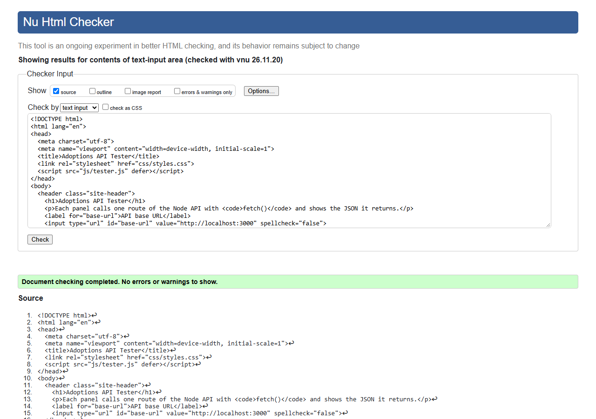
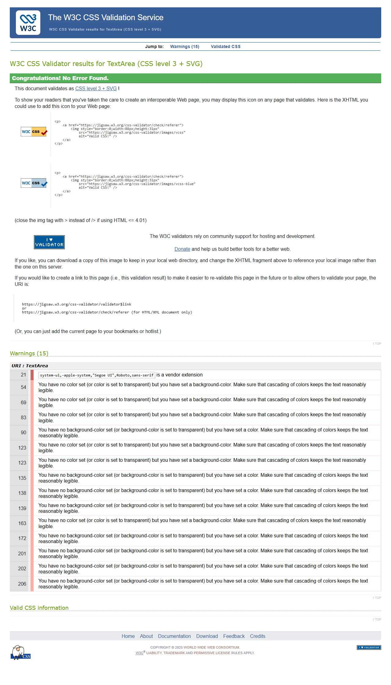
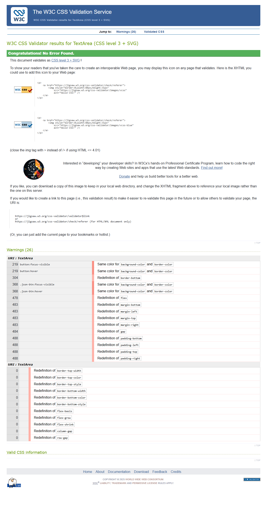
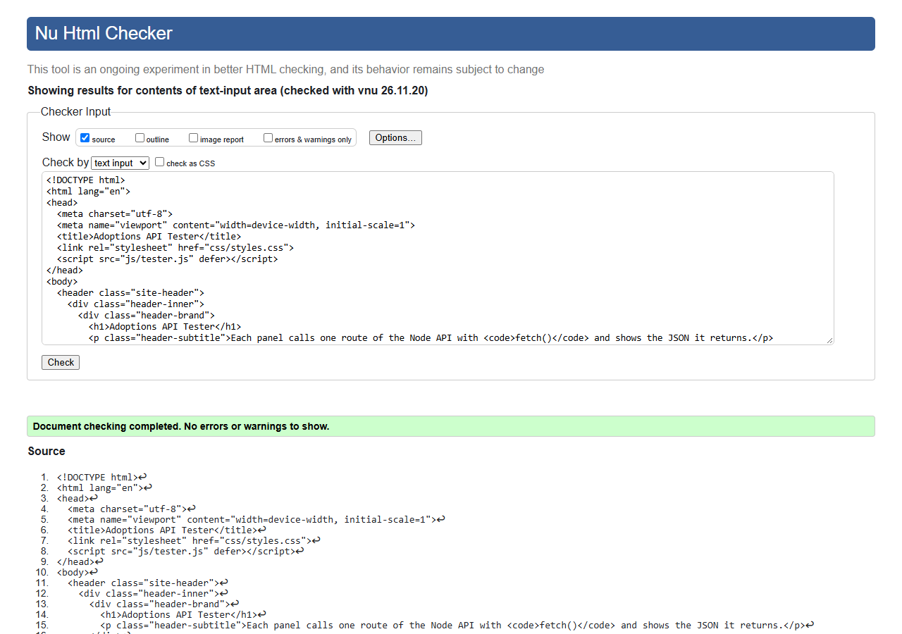
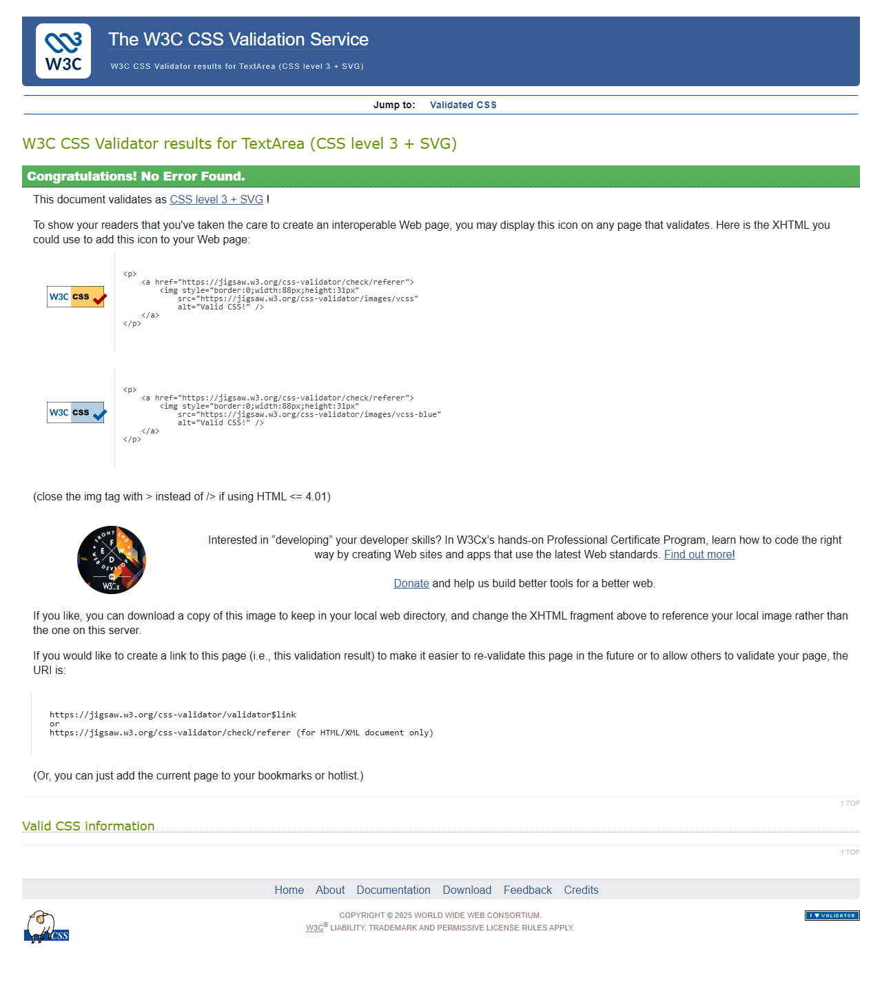
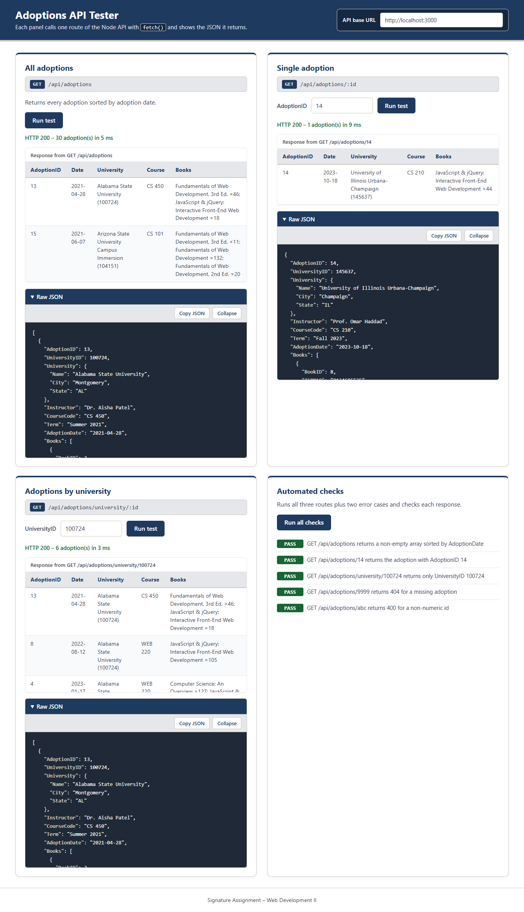
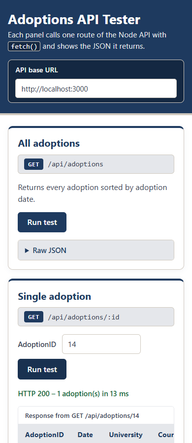
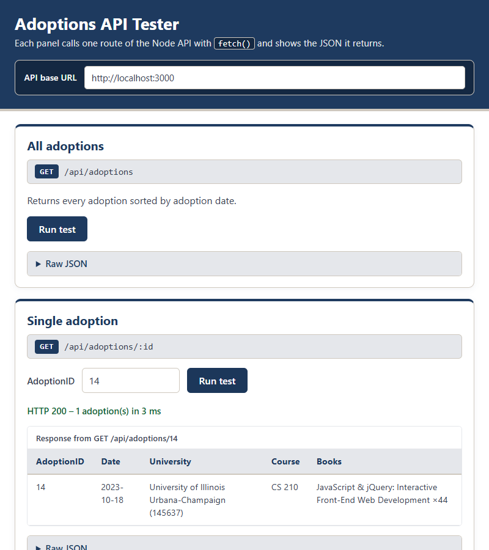

# HTML & CSS Validation Report: Adoptions API Tester

| | |
|---|---|
| **Files validated** | `public/index.html` (static source **and** rendered DOM), `public/css/styles.css` |
| **HTML validator** | W3C Nu Html Checker, vnu 26.11.20 (<https://validator.w3.org/nu/>) |
| **CSS validator** | W3C CSS Validation Service, profile *CSS level 3 + SVG*, warnings set to **All** (<https://jigsaw.w3.org/css-validator/>) |
| **Accessibility checker** | axe-core 4.10.2, run in headless Chrome against the live page |
| **Validation rounds** | 4: first draft → fixes → UI redesign → fixes |
| **Date** | 25 November 2026 |
| **Final result** | **HTML: 0 errors, 0 warnings. CSS: 0 errors, 0 warnings. axe-core: 0 violations. Contrast: every pair ≥ 7:1 (WCAG AAA).** |

---

## Contents

1. [Summary](#1-summary)
2. [Validation process](#2-validation-process)
3. [Round 1: first draft](#3-round-1-first-draft)
4. [Round 3: after the UI redesign](#4-round-3-after-the-ui-redesign)
5. [Error identification & analysis](#5-error-identification--analysis)
6. [Corrections & fix implementation](#6-corrections--fix-implementation)
7. [Final results (rounds 2 and 4)](#7-final-results-rounds-2-and-4)
8. [Why validation matters](#8-why-validation-matters)
9. [Evidence index](#9-evidence-index)

---

## 1. Summary

The page was validated four times. Validation was repeated after every change, not just once at the end:

* **Round 1 (first draft):** HTML was clean. The CSS validator reported **15 warnings**, and
  axe-core found **1 serious accessibility violation**.
* **Round 2:** all 16 issues were fixed and everything validated clean.
* **Round 3:** the UI was then redesigned (new navy/greige palette, header layout, Raw JSON toolbar,
  JSON syntax highlighting). Re-validating showed the redesign had introduced **26 new CSS warnings**.
  HTML stayed valid and accessibility stayed clean. *Passing once doesn't mean the code stays valid.*
* **Round 4:** the 26 warnings were fixed without changing how the page looks, and everything
  validated clean again.

| Round | Code version | Nu HTML (source) | Nu HTML (rendered DOM) | W3C CSS | axe-core |
|---|---|---|---|---|---|
| 1 | First draft ([`before/`](before/)) | 0 / 0 | 0 / 0 | 0 errors / **15 warnings** | **1 serious** |
| 2 | Fixes applied ([`round2/`](round2/)) | 0 / 0 | 0 / 0 | 0 / 0 | 0 |
| 3 | UI redesign ([`round3-ui-update/`](round3-ui-update/)) | 0 / 0 | 0 / 0 | 0 errors / **26 warnings** | 0 |
| 4 | **Final** ([`../public/`](../public/)) | **0 / 0** | **0 / 0** | **0 / 0** | **0** |

*"0 / 0" = errors / warnings.*

**Total issues found and fixed: 42** (15 + 1 in round 1, 26 in round 3).

---

## 2. Validation process

1. **Snapshot first.** Before changing anything in a round, the files being validated were copied
   to a snapshot folder ([`before/`](before/), [`round3-ui-update/`](round3-ui-update/)), so every fix
   has a real "before" to compare against. The round-2 files are kept in [`round2/`](round2/).
2. **Validate the HTML source.** `public/index.html` was pasted into the Nu Html Checker using
   **Check by: text input**, with **Show: source** ticked so the checked code appears in the report.
3. **Validate the rendered DOM.** The page builds its tables, captions, PASS/FAIL list and syntax-highlighted
   JSON with JavaScript, so validating only the source file would miss that markup. The page was loaded
   in headless Chrome, all four tests were run, every *Raw JSON* panel was opened, and
   `document.documentElement.outerHTML` was saved (`validation-logs/rendered-dom-*.html`) and
   submitted to the Nu Html Checker.
4. **Validate the CSS.** `public/css/styles.css` was pasted into the CSS validator's
   **By direct input** tab, with **More Options → Profile: CSS level 3 + SVG** and **Warnings: All**.
   The default "Normal report" level hides the colour and redefinition warnings analysed below.
5. **Accessibility and contrast.** The validators check syntax. They don't check keyboard access or colour contrast.
   axe-core was injected into the live page after the tests ran and the panels were opened. For the
   final palette, contrast ratios were also calculated by hand with the WCAG relative-luminance formula ([§7.3](#73-colour-contrast-final-palette)).
6. **Record evidence.** Each run's raw JSON output was saved in [`validation-logs/`](validation-logs/),
   and the validator result pages and the test page were screenshotted into [`screenshots/`](screenshots/).
7. **Fix, then repeat steps 2–6** until every tool reported zero issues.
8. **Regression check.** After the fixes, the API test suite was re-run (5/5 PASS). The page was
   also checked at 1366 px, 800 px and 390 px to confirm there's no horizontal scrolling and the layout is unchanged.

The automation scripts are in [`tools/`](tools/) so the whole process can be repeated.

---

## 3. Round 1: first draft

### 3.1 HTML: Nu Html Checker: no errors or warnings



The rendered-DOM check gave the same result ([`html-rendered-round1.json`](validation-logs/html-rendered-round1.json): `"messages": []`).
The page was written as HTML5 from the start: `<!DOCTYPE html>`, `lang="en"`, `<meta charset>` placed first, a
`<label for>` on every input, an explicit `type` on every `<button>`, a heading in every
`<section>`, and no deprecated elements. That's why the validator found nothing.

### 3.2 CSS: W3C CSS Validator: 0 errors, 15 warnings



Raw log: [`validation-logs/css-round1.json`](validation-logs/css-round1.json)

### 3.3 Accessibility: axe-core: 1 serious violation

Raw log: [`validation-logs/axe-before.json`](validation-logs/axe-before.json)

```text
serious  scrollable-region-focusable  "Scrollable region must have keyboard access"
         #all > .table-wrap
         #university > .table-wrap
```

---

## 4. Round 3: after the UI redesign

After round 2 passed cleanly, the interface was redesigned. The changes were a new colour palette, a two-column
header with a framed *API base URL* bar, card borders and shadows, striped tables, a *Copy JSON /
Collapse* toolbar, syntax-highlighted JSON, and a responsive `@media` block. The redesigned files
were snapshotted to [`round3-ui-update/`](round3-ui-update/) and the whole process was repeated.

### 4.1 HTML: still no errors or warnings


Both the source ([`html-round3.json`](validation-logs/html-round3.json)) and the rendered DOM, with all
Raw JSON panels open ([`html-rendered-round3.json`](validation-logs/html-rendered-round3.json)), returned `"messages": []`.

### 4.2 CSS: 0 errors, 26 new warnings



Raw log: [`validation-logs/css-round3.json`](validation-logs/css-round3.json)

### 4.3 Accessibility: 0 violations

axe-core found no violations in the redesigned page, including colour contrast of the new palette
([`axe-round3.json`](validation-logs/axe-round3.json)). The keyboard-access fixes from round 2
(`tabindex`, `role="region"`, unique `aria-label`s) were kept in the redesign.


---

## 5. Error identification & analysis

### 5.1 Round 1 issues (first draft)

| # | Tool | Line | Selector | Message (abridged) | Category | Severity |
|---|---|---|---|---|---|---|
| 1 | CSS | 21 | `body` | `system-ui, -apple-system, …` *is a vendor extension* | Vendor extension / non-standard value | Low |
| 2 | CSS | 54 | `.site-header code` | background set, no `color` | Colour cascade / legibility | Medium |
| 3 | CSS | 69 | `.route-card` | background set, no `color` | Colour cascade / legibility | Medium |
| 4 | CSS | 83 | `.route` | background set, no `color` | Colour cascade / legibility | Medium |
| 5 | CSS | 90 | `.verb` | `color` set, no background | Colour cascade / legibility | Medium |
| 6–7 | CSS | 123 | `button:hover`, `button:focus-visible` | background set, no `color` (reported once per selector) | Colour cascade / legibility | Medium |
| 8 | CSS | 135 | `.status` | `color` set, no background | Colour cascade / legibility | Medium |
| 9 | CSS | 138 | `.status.ok` | `color` set, no background | Colour cascade / legibility | Medium |
| 10 | CSS | 139 | `.status.fail` | `color` set, no background | Colour cascade / legibility | Medium |
| 11 | CSS | 163 | `th` | background set, no `color` | Colour cascade / legibility | Medium |
| 12 | CSS | 172 | `summary` | `color` set, no background | Colour cascade / legibility | Medium |
| 13 | CSS | 201 | `.checks li.pass::before` | `color` set, no background | Colour cascade / legibility | Medium |
| 14 | CSS | 202 | `.checks li.fail::before` | `color` set, no background | Colour cascade / legibility | Medium |
| 15 | CSS | 206 | `footer` | `color` set, no background | Colour cascade / legibility | Medium |
| 16 | axe-core | – | `.table-wrap` (×3), `pre.output` (×3) | Scrollable region must have keyboard access (WCAG 2.1.1, Level A) | **Accessibility** | **High (serious)** |

**Issue 1: vendor extension.** `-apple-system` is a proprietary keyword that only Safari/WebKit
understands. It isn't in any CSS specification. It was a work-around from before Safari supported the
standard `system-ui` keyword. Every current browser supports `system-ui` (Safari since version 11), so the
proprietary keyword is now redundant.

**Issues 2–15: colour set without its partner.** The validator checks that every rule setting a
foreground colour also sets a background colour, and vice versa. The draft relied on inheritance: for example,
`.route-card` set a white background and assumed the text would inherit dark text from `body`.
That works, but legibility then depends on the cascade. If the rule is reused somewhere else, or a parent's colour
changes (a dark theme, say), the text could end up the same colour as its background. Issues 6–7
show the risk: `button:hover` changed the background and relied on the base `button` rule for
white text.

**Issue 16: keyboard-inaccessible scroll regions.** `.table-wrap` and `pre.output` have a
`max-height` plus `overflow: auto`, so long results scroll *inside* the box. A mouse user can scroll
them, but a keyboard-only user can't: a `<div>`/`<pre>` isn't focusable, so the arrow keys never
reach it. axe-core flagged the two tables that actually overflowed during the test. The other table and all
three `<pre>` boxes have the same structure, so all six were fixed. The HTML validator **can't**
catch this because the markup is syntactically valid. Only a tool that inspects the live, styled page
can see that an element scrolls.

### 5.2 Round 3 issues (introduced by the UI redesign)

Line numbers refer to [`round3-ui-update/styles.css`](round3-ui-update/styles.css). The validator reports
some warnings on "line 0". These are the longhand properties it expands from a shorthand, and they're
grouped under the shorthand that caused them.

| # | Line | Selector | Message | Count | Category | Severity |
|---|---|---|---|---|---|---|
| 17–20 | 219, 368 | `button:hover`, `button:focus-visible`, `.json-btn:hover`, `.json-btn:focus-visible` | Same color for `background-color` and `border-color` | 4 | Redundant declaration / colour | Low |
| 21–23 | 128 (reported as 0) | `.route-card` | Redefinition of `border-top-width`, `-color`, `-style` | 3 | Redefinition / shorthand override | Low |
| 24–27 | 291, 304 (+0) | `th, td` then `th` | Redefinition of `border-bottom` (+ `-width`, `-color`, `-style`) | 4 | Redefinition / **CSS specificity & cascade** | Low |
| 28–42 | 478–488 (+0) | `.base-url-bar`, `main`, `.route-card` inside `@media (max-width: 52rem)` | Redefinition of `flex` (+3 longhands), `margin` ×4, `gap` (+`row-gap`, `column-gap`), `padding` ×4 | 15 | Redefinition / responsive override | Low |

**Root causes**

* **Issues 17–20: same colour for background and border.** The redesign gave buttons a 1 px border in exactly
  the same colour as their fill (`border-color: var(--navy-dark)` on a `var(--navy-dark)` background).
  A border in the same colour as the background is invisible, so the declaration adds nothing. The validator
  flags it because it's usually a mistake, such as a copy-paste error or a forgotten focus style. It also
  means the colour has to be kept in sync in two places.
* **Issues 21–23: shorthand then override in the same rule.** `.route-card` set `border: 1px solid greige`
  and then immediately `border-top: 4px solid navy`. The browser handles this correctly (the later
  declaration wins), but the top border is declared twice, and someone reading the rule has to work out the
  final result.
* **Issues 24–27: two rules for one element.** `th, td` gave both cell types a 1 px `border-bottom`, and the
  later, equally specific `th` rule replaced it with a 2 px border. The result depends **only on source order**,
  because the specificity of `th` (0-0-1) equals that of `th, td` (0-0-1). Moving the `th` rule above `th, td`
  would silently change how the header looks. This is the CSS-specificity issue in this project.
* **Issues 28–42: responsive overrides.** The `@media (max-width: 52rem)` block re-declared `flex`,
  `margin`, `gap` and `padding` for small screens. These overrides are intentional. But we tested the
  validator directly with minimal CSS samples, and **it reports any property re-declared inside a media query
  as a redefinition**, even when the declarations are split across separate `min-width`/`max-width` blocks:

  | Test CSS sent to the validator | Warnings |
  |---|---|
  | `a{flex:0 1 28rem} @media (max-width:52rem){a{flex:1 1 100%}}` | 4 (redefinition) |
  | Same values split into separate `min-width` / `max-width` blocks | 4 (redefinition) |
  | `main{margin:clamp(1.35rem, .5rem + 1.6vw, 2rem) auto}`, no media query | **0** |

  These warnings are partly a validator limitation. They also pointed to a better design: spacing that
  scales smoothly with `clamp()` and a layout that wraps based on available space, instead of jumping
  at a single breakpoint.

### 5.3 Categories checked that had no issues

| Category | Result |
|---|---|
| HTML syntax (unclosed/misnested tags, duplicate IDs, invalid attributes, bad nesting) | None in any round, in both source and rendered DOM. That includes the redesign's nested `<button>`s inside `<details>` and the `<span>`s generated for JSON highlighting |
| Deprecated / obsolete HTML (`<center>`, `<font>`, `align=`, `bgcolor=`) | None |
| Form labelling (`<label for>` ↔ `id`) | All 3 inputs labelled |
| ARIA usage | Every `aria-label` sits on an element with a role that allows naming (`role="region"`) |
| CSS syntax / unknown properties / invalid values | 0 errors in every round |
| CSS specificity (whole stylesheet) | No ID selectors and no `!important`. The highest specificity is `.checks li.pass::before` (0-2-2). Modifier states (`.status.ok`, `.json-btn:hover`, `details[open] summary`) are intentionally one class or attribute heavier than their base rule, so they win by specificity, not source order. The only order-dependent pair (`th` vs `th, td`) was fixed in round 4 |
| Colour contrast | axe-core `color-contrast` passed in every round. Final palette ratios are in §7.3 |

---

## 6. Corrections & fix implementation

### 6.1 Round 1 → Round 2 fixes

#### Fix 1: Remove the vendor-specific font keyword (Issue 1)

```css
/* BEFORE */
body { font-family: system-ui, -apple-system, "Segoe UI", Roboto, sans-serif; }

/* AFTER */
body { font-family: system-ui, "Segoe UI", Roboto, sans-serif; }
```

`system-ui` is the standard keyword (CSS Fonts Level 4) and gives the same platform font in every current browser.

#### Fix 2: Pair every `color` with a `background` (Issues 2–15)

Every flagged rule now sets both properties. The added value always matches the colour the element was
already displayed on, so the page looks exactly the same, and contrast is now guaranteed by the rule itself.

```css
/* BEFORE */                              /* AFTER */
.route-card {                             .route-card {
  background: var(--card);                  background: var(--card);
  border: 1px solid var(--border);          color: var(--text);
}                                           border: 1px solid var(--border);
                                          }

button:hover,                             button:hover,
button:focus-visible {                    button:focus-visible {
  background: var(--accent-dark);           background: var(--accent-dark);
}                                           color: #fff;
                                          }

.status.ok   { color: var(--ok); }        .status.ok   { color: var(--ok);   background: var(--card); }
.status.fail { color: var(--fail); }      .status.fail { color: var(--fail); background: var(--card); }

footer {                                  footer {
  color: var(--muted);                      color: var(--muted);
}                                           background: var(--bg);
                                          }
```

The same pattern was applied to `.site-header code`, `.route`, `.verb`, `.status`, `th`, `summary` and both
`.checks li::before` rules. Full diff: [`before/styles.css`](before/styles.css) → [`round2/styles.css`](round2/styles.css).

#### Fix 3: Make scrollable regions keyboard-accessible (Issue 16)

```html
<!-- BEFORE -->
<div class="table-wrap"></div>
<details><summary>Raw JSON</summary><pre class="output"></pre></details>

<!-- AFTER -->
<div class="table-wrap" tabindex="0" role="region"
     aria-label="All adoptions: results table"></div>
<details><summary>Raw JSON</summary>
  <pre class="output" tabindex="0" role="region"
       aria-label="All adoptions: raw JSON"></pre></details>
```

* `tabindex="0"` puts the box in the Tab order, so keyboard users can focus it and scroll with the arrow keys.
* `role="region"` plus a **unique** `aria-label` tells screen-reader users what they've landed on. Each card
  uses its own label so the six regions can be told apart.
* `role="region"` is also needed on `<pre>`. Without a role, `<pre>` has the *generic* ARIA role, and
  `aria-label` isn't allowed on generic elements (ARIA 1.2).

Focusable elements also need a visible focus indicator (WCAG 2.4.7), so the focus ring was extended:

```css
/* BEFORE */                    /* AFTER */
button:focus-visible,           button:focus-visible,
input:focus-visible {           input:focus-visible,
  outline: 3px solid #f2b705;   .table-wrap:focus-visible,
}                               pre.output:focus-visible {
                                  outline: 3px solid #f2b705;
                                }
```

#### Fix 4 (improvement): Table captions

No tool flagged this, but the generated tables had no accessible name. `tester.js` now adds a `<caption>`:

```js
// BEFORE
function buildTable(data) {
  const table = document.createElement('table');

// AFTER
function buildTable(data, captionText) {
  const table = document.createElement('table');
  table.createCaption().textContent = captionText;   // e.g. "Response from GET /api/adoptions/14"
```

### 6.2 Round 3 → Round 4 fixes

Full diff: [`round3-ui-update/styles.css`](round3-ui-update/styles.css) → [`../public/css/styles.css`](../public/css/styles.css).
No HTML or JavaScript changes were needed.

#### Fix 5: Transparent border instead of a same-colour border (Issues 17–20)

```css
/* BEFORE */                                  /* AFTER */
button {                                      button {
  border: 1px solid var(--navy);                border: 1px solid transparent;
  background-color: var(--navy);                background-color: var(--navy);
}                                             }

button:hover,                                 button:hover,
button:focus-visible {                        button:focus-visible {
  background-color: var(--navy-dark);           background-color: var(--navy-dark);
  color: var(--white);                          color: var(--white);
  border-color: var(--navy-dark);             }
}

.json-btn:hover,                              .json-btn:hover,
.json-btn:focus-visible {                     .json-btn:focus-visible {
  background-color: var(--navy);                background-color: var(--navy);
  color: var(--white);                          color: var(--white);
  border-color: var(--navy);                    border-color: transparent;
}                                             }
```

**Why it works:** the background is painted under the border (`background-clip: border-box` by default),
so a transparent border shows exactly the fill colour. The button looks the same in every state, but the
colour is now written once instead of twice. The 1 px border is kept so the button doesn't change size between states.

#### Fix 6: Longhand borders instead of shorthand plus override (Issues 21–23)

```css
/* BEFORE */                                  /* AFTER */
.route-card {                                 .route-card {
  border: 1px solid var(--greige);              border-style: solid;
  border-top: 4px solid var(--navy);            border-width: 4px 1px 1px;
}                                               border-color: var(--navy) var(--greige) var(--greige);
                                              }
```

**Why it works:** each property is declared once. `border-width` and `border-color` use the top/sides/bottom
shorthand order, so the 4 px navy top accent is described in one place instead of being overwritten.

#### Fix 7: Don't rely on source order between `th` and `th, td` (Issues 24–27)

```css
/* BEFORE */                                  /* AFTER */
th, td {                                      th, td {
  padding: 0.6rem 0.85rem;                      padding: 0.6rem 0.85rem;
  border-bottom: 1px solid var(--light-gray);   text-align: left;
  text-align: left;                           }
}
th {                                          th {
  border-bottom: 2px solid var(--greige);       border-bottom: 2px solid var(--greige);
}                                             }
td {                                          td {
  background-color: var(--white);               background-color: var(--white);
}                                               border-bottom: 1px solid var(--light-gray);
                                              }
```

**Why it works:** the shared rule now holds only what `th` and `td` really share. Each cell type declares
its own border once, so reordering the rules can no longer change the result.

#### Fix 8: Fluid layout instead of a media-query override (Issues 28–42)

```css
/* BEFORE */
.header-brand { flex: 1 1 26rem; }
.base-url-bar { flex: 0 1 28rem; }
main          { gap: 1.5rem 1.75rem; margin: 2rem auto; }
.route-card   { padding: 1.35rem 1.5rem; }

@media (max-width: 52rem) {
  .base-url-bar { flex: 1 1 100%; width: 100%; }
  main          { margin: 1.35rem auto; gap: 1.15rem; }
  .route-card   { padding: 1.1rem 1.2rem; }
}

/* AFTER (no media query) */
.header-brand { flex: 999 1 26rem; }
.base-url-bar { flex: 1 1 28rem; }
main {
  gap: clamp(1.15rem, 0.4rem + 1.4vw, 1.5rem) clamp(1.15rem, 0.1rem + 2vw, 1.75rem);
  margin: clamp(1.35rem, 0.5rem + 1.6vw, 2rem) auto;
}
.route-card {
  padding: clamp(1.1rem, 0.6rem + 0.9vw, 1.35rem) clamp(1.2rem, 0.6rem + 1.1vw, 1.5rem);
}
```

**Why it works:**

* **Header.** Both header items can grow, but the title's grow factor (`999`) is so much larger that on
  a wide screen it takes nearly all the spare space, and the URL bar stays about 28 rem wide, as before.
  When the screen is too narrow for both, the bar wraps onto its own line. There it is the only item, so it
  stretches to full width, which is what the old media query did by hand. It now responds to the space actually
  available instead of a fixed 52 rem breakpoint.
* **Spacing.** `clamp(min, preferred, max)` scales spacing with the viewport. The minimum and maximum are the old
  mobile and desktop values, so the page matches the old design at both ends and moves smoothly in between,
  with no sudden jump at 832 px.

**Verified:** at 390 px the URL bar is 358 px wide (full width minus the page gutter) and at 800 px it's 752 px.
`scrollWidth` equals the viewport width at both sizes, so there's no horizontal scrolling. See the
screenshots in §7.4.

---

## 7. Final results (rounds 2 and 4)

### 7.1 HTML: Nu Html Checker: no errors or warnings



* Source: [`html-round4.json`](validation-logs/html-round4.json) → `"messages": []`
* Rendered DOM after running every test with all Raw JSON panels open ([`rendered-dom-final.html`](validation-logs/rendered-dom-final.html)):
  [`html-rendered-round4.json`](validation-logs/html-rendered-round4.json) → `"messages": []`

### 7.2 CSS: W3C CSS Validator: 0 errors, 0 warnings (Warnings: All)



Raw log: [`css-round4.json`](validation-logs/css-round4.json) → `"errorcount": 0, "warningcount": 0`

*Round 2 had the same clean result for the pre-redesign stylesheet. See
[`css-validator-after.png`](screenshots/css-validator-after.png), [`html-validator-after.png`](screenshots/html-validator-after.png) and [`css-round2.json`](validation-logs/css-round2.json).*

### 7.3 Accessibility and colour contrast

axe-core: **0 violations** ([`axe-final.json`](validation-logs/axe-final.json)).

Contrast ratios for every text and colour pair in the final palette, calculated with the WCAG 2.x
relative-luminance formula. AA needs 4.5:1 for normal text, and **AAA needs 7:1**:

| Element | Foreground on background | Ratio | WCAG |
|---|---|---|---|
| Body / card text | `#374151` on `#FFFFFF` | 10.31:1 | AAA |
| Headings, summary | `#1E3A5F` on `#FFFFFF` | 11.50:1 | AAA |
| Table header text | `#1E3A5F` on `#E5E7EB` | 9.29:1 | AAA |
| Header title | `#FFFFFF` on `#1E3A5F` | 11.50:1 | AAA |
| Header subtitle | `#E5E7EB` on `#1E3A5F` | 9.29:1 | AAA |
| API base URL label | `#FFFFFF` on `#142842` | 14.87:1 | AAA |
| Route path text | `#374151` on `#E5E7EB` | 8.33:1 | AAA |
| Striped table row | `#374151` on `#F9FAFB` | 9.86:1 | AAA |
| Buttons / GET badge | `#FFFFFF` on `#1E3A5F` | 11.50:1 | AAA |
| Button hover / focus | `#FFFFFF` on `#142842` | 14.87:1 | AAA |
| Status OK text | `#166534` on `#FFFFFF` | 7.13:1 | AAA |
| Status FAIL text | `#991B1B` on `#FFFFFF` | 8.31:1 | AAA |
| PASS badge | `#FFFFFF` on `#166534` | 7.13:1 | AAA |
| FAIL badge | `#FFFFFF` on `#991B1B` | 8.31:1 | AAA |
| Raw JSON text | `#FFFFFF` on `#1F2937` | 14.68:1 | AAA |
| JSON keys / placeholder | `#CFC8BE` on `#1F2937` | 8.85:1 | AAA |
| JSON values | `#E5E7EB` on `#1F2937` | 11.86:1 | AAA |
| Focus ring (page) | `#1E3A5F` on `#FFFFFF` | 11.50:1 | ≥ 3:1 required (WCAG 1.4.11) |
| Focus ring (URL bar) | `#FFFFFF` on `#142842` | 14.87:1 | ≥ 3:1 required (WCAG 1.4.11) |

### 7.4 Functional and responsive regression check

The test page still passes all 5 API checks after the fixes:



| Phone (390 px) | Tablet (800 px) |
|---|---|
|  |  |

---

## 8. Why validation matters

**Browser compatibility.** Browsers are very forgiving. When they meet invalid markup, each engine
*guesses* what the author meant, and different engines can guess differently. Valid code removes the
guessing, so the page renders the same in Chrome, Firefox, Safari and Edge. Issue 1 shows the CSS side of
this: a keyword written for one engine (`-apple-system`) is ignored by the others, while the standard
`system-ui` works everywhere.

**Accessibility.** Screen readers and other assistive technology read the DOM, not the screen. If a label
points to the wrong `id`, or headings and landmarks are malformed, those users lose information without any
warning. Validation catches the structural problems. Issue 16 shows that an accessibility checker
is still needed on top of it: the markup was 100% valid, yet keyboard-only users couldn't scroll the results.
Using the HTML validator, CSS validator and axe-core together covers what each one misses. Issues 2–15
are also accessibility issues: pairing colours stops low-contrast text from appearing through the cascade.

**Performance.** When the parser has to recover from errors (unclosed elements, misnested tags), it does
extra work and can build the DOM in unexpected ways, which leads to extra style and layout recalculation.
Clean markup parses in one predictable pass. On the CSS side, redundant declarations (Issues 17–27) are bytes
the browser downloads, parses and then throws away. Fix 8 replaced a media query and its overrides with single
`clamp()` declarations, so there are fewer rules to match.

**Maintainability.** Valid, standards-based code means what it says. Round 3 shows why this matters in
practice: a redesign that *looked* finished had quietly added 26 warnings, including a rule pair whose
result depended only on source order (Issues 24–27). Because round 2 had left a clean baseline,
every new warning was easy to spot and trace to the change that caused it. Fixes 2, 5, 6 and 7
each make a rule self-contained, so moving or reusing a component can't silently break its appearance.

**Standards compliance & future-proofing.** The W3C/WHATWG specifications are the contract between authors
and browser vendors. Code that follows them keeps working as browsers evolve. Code that relies on error
recovery, deprecated tags (`<font>`, `<center>`) or vendor-only features can break when that behaviour
changes. Many organisations, and laws such as the ADA and Section 508, require standards-based, accessible
markup (WCAG 2.1 AA). The final page meets AA, and its colours meet AAA.

**Professionalism and SEO.** Search engines and social-media crawlers parse HTML too, and a valid structure
(one `<h1>`, ordered headings, labelled controls) helps them understand the content correctly.

**Lesson from this project:** validation is not a one-time step at the end. Round 3 shows that
re-validating after every significant change catches problems while they're still easy to fix.

---

## 9. Evidence index

| Round | Code snapshot | Screenshots | Logs |
|---|---|---|---|
| 1: First draft | [`before/index.html`](before/index.html), [`before/styles.css`](before/styles.css) | [`html-validator-before.png`](screenshots/html-validator-before.png), [`css-validator-before.png`](screenshots/css-validator-before.png), [`test-page-before.png`](screenshots/test-page-before.png) | [`html-round1.json`](validation-logs/html-round1.json), [`html-rendered-round1.json`](validation-logs/html-rendered-round1.json), [`css-round1.json`](validation-logs/css-round1.json), [`axe-before.json`](validation-logs/axe-before.json), [`rendered-dom-before.html`](validation-logs/rendered-dom-before.html) |
| 2: Fixes | [`round2/index.html`](round2/index.html), [`round2/styles.css`](round2/styles.css) | [`html-validator-after.png`](screenshots/html-validator-after.png), [`css-validator-after.png`](screenshots/css-validator-after.png), [`test-page-after.png`](screenshots/test-page-after.png) | [`html-round2.json`](validation-logs/html-round2.json), [`html-rendered-round2.json`](validation-logs/html-rendered-round2.json), [`css-round2.json`](validation-logs/css-round2.json), [`axe-after.json`](validation-logs/axe-after.json), [`rendered-dom-after.html`](validation-logs/rendered-dom-after.html) |
| 3: UI redesign | [`round3-ui-update/`](round3-ui-update/) (`index.html`, `styles.css`, `tester.js`) | [`html-validator-ui-update.png`](screenshots/html-validator-ui-update.png), [`css-validator-ui-update.png`](screenshots/css-validator-ui-update.png), [`test-page-ui-update.png`](screenshots/test-page-ui-update.png) | [`html-round3.json`](validation-logs/html-round3.json), [`html-rendered-round3.json`](validation-logs/html-rendered-round3.json), [`css-round3.json`](validation-logs/css-round3.json), [`axe-round3.json`](validation-logs/axe-round3.json), [`rendered-dom-round3.html`](validation-logs/rendered-dom-round3.html) |
| 4: **Final** | [`../public/index.html`](../public/index.html), [`../public/css/styles.css`](../public/css/styles.css) | [`html-validator-final.png`](screenshots/html-validator-final.png), [`css-validator-final.png`](screenshots/css-validator-final.png), [`test-page-final.png`](screenshots/test-page-final.png), [`-390px`](screenshots/test-page-final-390px.png), [`-800px`](screenshots/test-page-final-800px.png) | [`html-round4.json`](validation-logs/html-round4.json), [`html-rendered-round4.json`](validation-logs/html-rendered-round4.json), [`css-round4.json`](validation-logs/css-round4.json), [`axe-final.json`](validation-logs/axe-final.json), [`rendered-dom-final.html`](validation-logs/rendered-dom-final.html) |

Other: [`tools/`](tools/) (automation scripts) · [`evidence/sample-queries-output.txt`](evidence/sample-queries-output.txt) (MongoDB sample queries)
